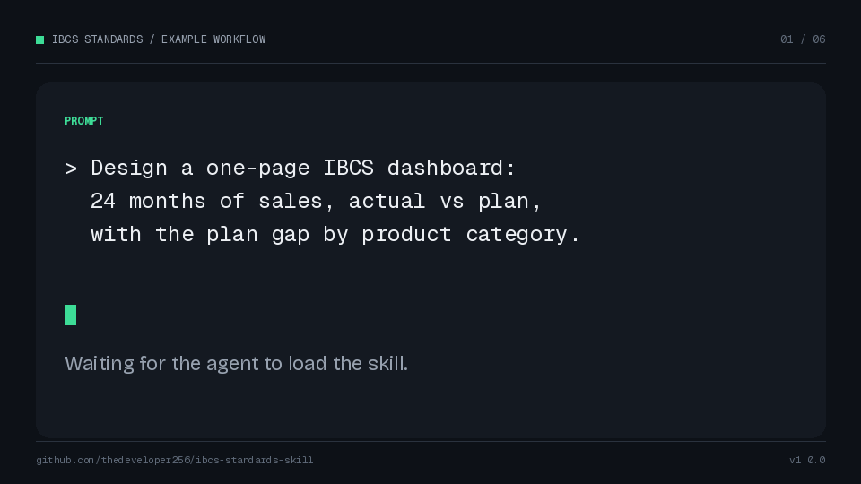

# IBCS Standards Skill



*Example run. The key message and audit finding come from the project's development evaluations.*

An agent skill for IBCS v2.0 business reporting. It covers report design, review, repair, and explanation for dashboards, charts, tables, KPI pages, variance analyses, and scenario comparisons.

The skill uses a standard `SKILL.md` entry point with relative references. It runs in OpenCode, Claude Code, Codex-style `AGENTS.md` harnesses, rules-based editors, and any other agent that can read a skill directory or follow a pointer.

It covers all 35 top-level rules and 105 sub-rules across SIMPLIFY, UNIFY, CHECK, SAY, STRUCTURE, EXPRESS, and CONDENSE. It also includes semantic notation, a chart and table catalog, a composition playbook, five worked examples, an audit checklist, a completeness map, a glossary, and guides for Python, Power BI, Excel, and HTML/JS.

> **Independent derivative work.** This repository is not affiliated with, endorsed by, or certified by the IBCS Association, the authors of IBCS v2.0, or ISO. It is a working summary, not a substitute for the official IBCS source or ISO 24896 for legal, certification, or formal-compliance purposes. IBCS is a registered trademark of IBCS Institute.

## Who this is for

This skill is for people who already know the reporting problem and want an agent to apply IBCS consistently:

- FP&A and controlling teams who need report pages and variance explanations that follow the same rules.
- BI analysts and report designers working in Power BI, Excel, Python, or web dashboards.
- Reviewers who audit dashboards against IBCS and need to cite rule IDs.
- AI-agent users who want domain rules available without pasting the source PDF into context.

## What this replaces

The skill replaces the slow lookup, not the standard. A rule that used to require searching the 169-page IBCS v2.0 PDF now sits in a compact rule file with the same ID and source page. The agent can cite `CH 1.1` or `UN 4.1` and run the audit checklist instead of relying on memory. Each page review uses the same notation, composition, and integrity checks.

The skill does not replace the source for formal compliance, certification, or figure-level detail. For those, use the official IBCS source and ISO 24896.

## What's in the repo

```text
.opencode/skills/ibcs-standards/
├── SKILL.md
├── LICENSE
├── assets/
│   ├── page-spec-template.md
│   └── starter-tokens.json
└── references/
    ├── framework.md
    ├── glossary.md
    ├── semantic-notation.md
    ├── chart-and-table-catalog.md
    ├── composition-playbook.md
    ├── worked-examples.md
    ├── audit-checklist.md
    ├── completeness-map.md
    ├── source-and-license.md
    ├── implementation/
    │   ├── python.md
    │   ├── powerbi.md
    │   ├── excel.md
    │   └── html-js.md
    └── rules/
        ├── si-simplify.md
        ├── un-unify.md
        ├── ch-check.md
        ├── sa-say.md
        ├── st-structure.md
        ├── ex-express.md
        └── co-condense.md
```

The copy in this repo is at `.opencode/skills/ibcs-standards/`. Copy that folder to the path your harness expects. The folder name is the skill ID.

Also in the repo:

- `AGENTS.md`: a pointer for Codex-style and other `AGENTS.md`-based harnesses.
- `scripts/verify_skill.py`: checks rule counts, entry schema, router targets, coverage map, and required files. It auto-detects `.opencode/`, `.claude/`, `.agents/`, or `skills/`, and accepts `--skill-dir` for any other location.
- `scripts/install-skill.ps1` and `scripts/install-skill.sh`: one-command installers.
- `docs/media/demo.gif` and `docs/media/social-preview.png`: the workflow demo and GitHub social card.
- `docs/superpowers/specs/2026-10-20-ibcs-standards-skill-design.md`: design and acceptance criteria.
- `BENCHMARK.md`: current closed-book evaluation summary.

The source PDF is not redistributed in this repository.

## Install

The skill is plain Markdown. `SKILL.md` is the entry point; all references are relative to it. Copy the whole `ibcs-standards` folder and keep its name. Copying only `SKILL.md` leaves the references behind.

### One command

PowerShell 5.1 or later:

```powershell
irm https://raw.githubusercontent.com/thedeveloper256/ibcs-standards-skill/main/scripts/install-skill.ps1 | iex
```

bash with `curl` and `tar`:

```bash
curl -fsSL https://raw.githubusercontent.com/thedeveloper256/ibcs-standards-skill/main/scripts/install-skill.sh | bash
```

Both install to `.opencode/skills/ibcs-standards` in the current directory. The scripts also accept a different target:

```bash
curl -fsSL https://raw.githubusercontent.com/thedeveloper256/ibcs-standards-skill/main/scripts/install-skill.sh | bash -s -- .claude/skills/ibcs-standards
```

```powershell
& ([scriptblock]::Create((irm https://raw.githubusercontent.com/thedeveloper256/ibcs-standards-skill/main/scripts/install-skill.ps1))) -Target ".claude/skills/ibcs-standards"
```

Use `--global` with the bash script, or `-Global` with the PowerShell script, for a global OpenCode install.

| Harness | Project install | Global install |
|---|---|---|
| OpenCode | `.opencode/skills/ibcs-standards/` | `~/.config/opencode/skills/ibcs-standards/` |
| Claude Code | `.claude/skills/ibcs-standards/` | `~/.claude/skills/ibcs-standards/` |
| Other `SKILL.md`-compatible harness | its configured `skills/ibcs-standards/` | its global skills directory |
| Codex / `AGENTS.md`-based harness | folder anywhere + pointer in `AGENTS.md` | pointer in the global `AGENTS.md` |
| Cursor, Copilot, Windsurf, rules-based editors | folder anywhere + pointer in the rules file | same |

On Windows, the global paths are:

```text
C:\Users\<username>\.config\opencode\skills\ibcs-standards
C:\Users\<username>\.claude\skills\ibcs-standards
```

### OpenCode

```text
<project>\.opencode\skills\ibcs-standards
~/.config/opencode/skills/ibcs-standards
```

OpenCode discovers the project or global skill automatically. In a session, you can also mention `@ibcs-standards` to load it explicitly. Start a new session after copying if it does not appear immediately.

### Claude Code

```text
<project>\.claude\skills\ibcs-standards
~/.claude/skills/ibcs-standards
```

Claude Code discovers both locations and loads `SKILL.md` when the skill matches the task. It reloads changes in these directories automatically. If a newly copied skill does not appear, run `/reload-skills` or restart the session. You can also ask for the skill by name.

### Codex and other `AGENTS.md`-based harnesses

Codex builds differ in native skill discovery. The portable method is a pointer in the project’s `AGENTS.md` (or the equivalent global instruction file):

```markdown
## IBCS reporting

Before any IBCS, business-reporting, dashboard, chart, table, variance, or
scenario task, read `.opencode/skills/ibcs-standards/SKILL.md` and follow the
files it references.
```

Keep the skill folder anywhere in the project and adjust the path in the pointer. If your Codex build supports native skill directories, copy the folder into its configured skills directory instead and keep the pointer as a fallback.

### Cursor, Copilot, Windsurf, and other rules-based editors

These tools do not share a native skill directory. Use their instruction file as the entry point. For example:

- Cursor: add `.cursor/rules/ibcs-standards.mdc` with the pointer above.
- GitHub Copilot: add the pointer to `.github/copilot-instructions.md`.
- Windsurf or another rules-based editor: add it to the editor’s project rules file.
- Any harness that supports a skill directory: point it at the `ibcs-standards` folder directly.

The pointer only needs to tell the agent to read `SKILL.md` first. The skill routes to the relevant references from there.

### Any other `SKILL.md`-compatible harness

Copy the folder into the harness’s skill directory. The layout is standard:

```text
ibcs-standards/
├── SKILL.md
├── assets/
└── references/
```

If the harness accepts a path to a skill directory, point it at this folder. If it only supports instruction files, use the pointer pattern above.

### VS Code

- OpenCode extension: project skill at `.opencode/skills/ibcs-standards/`.
- Claude Code extension: project skill at `.claude/skills/ibcs-standards/`.
- GitHub Copilot: pointer in `.github/copilot-instructions.md`.

Reload the VS Code window or start a new agent session after installing.

### Use it

Open the project, start a session, and ask an IBCS question, for example:

> Design a one-page IBCS dashboard showing 24 months of sales actual vs plan, with the plan gap by product category.

The agent should load `SKILL.md` automatically when the task matches. You can also name the skill explicitly.

## Verify the package

From the repository root:

```powershell
python scripts/verify_skill.py
```

Expected result:

```text
PASS: skill package meets structural checks.
```

The verifier checks `.opencode/` first, then `.claude/`, `.agents/`, and `skills/`. If the skill is installed somewhere else, pass the folder explicitly:

```powershell
python scripts/verify_skill.py --skill-dir "C:\path\to\ibcs-standards"
```

It checks the exact rule counts (SI 14, UN 18, CH 15, SA 14, ST 14, EX 14, CO 16), the 105-row completeness map, required rule-entry fields, router targets, JSON validity, and required sections.

## Evaluation

The closed-book evaluation scored 94.0% with the skill and 44.9% without it across five tasks: rule retrieval, page design, audit, encoding, and tool implementation. The page-design task scores 9/9 with a shared legend and full integrity checks.

See [`BENCHMARK.md`](BENCHMARK.md) for the per-task results and caveats. These are development evaluations, not a certification or a guarantee of correctness.

Questions and feedback: [GitHub Discussions](https://github.com/thedeveloper256/ibcs-standards-skill/discussions).

## License and attribution

The repository content is licensed under CC BY-SA 4.0. See [`LICENSE`](LICENSE) and the skill’s [`source-and-license.md`](.opencode/skills/ibcs-standards/references/source-and-license.md).

Source attribution: *International Business Communication Standards (IBCS) Version 2.0*, Rolf Hichert and Jürgen Faisst, IBCS Media, Hilden, 2026, ISBN 978-3-9821414-4-2, licensed under CC BY-SA 4.0. This repository condenses and rewrites the material for closed-book agent use and does not reproduce the source figures or ISO 24896 text.
